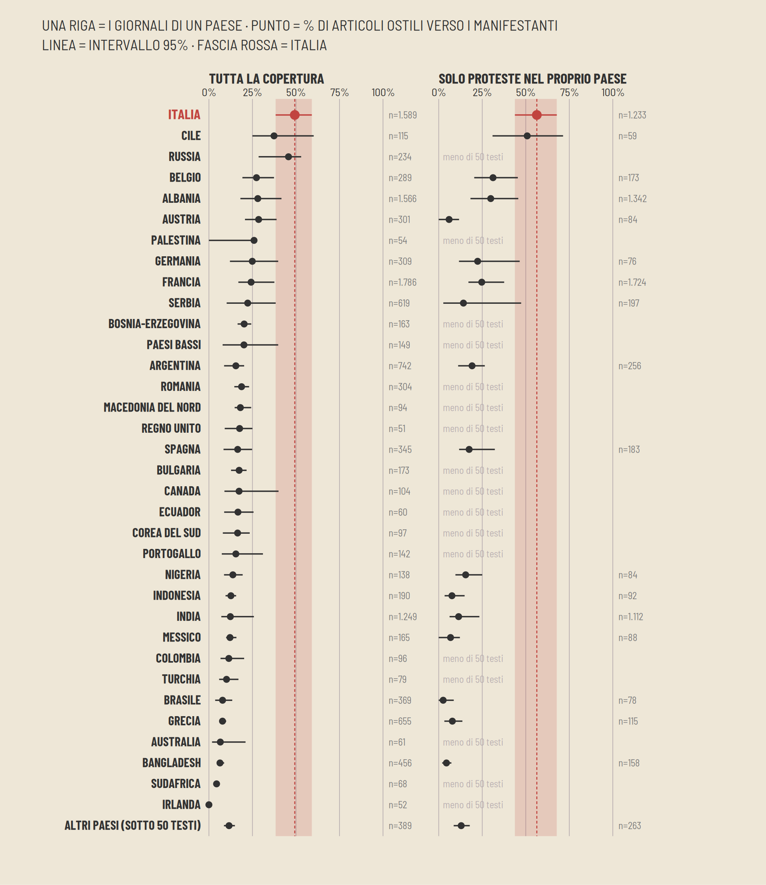

# Media coverage of the 2026 youth protests

This repository contains code and data for the [Scomodo](https://www.scomodo.org) Parallasse piece on how newspapers covered the youth protests of autumn 2026 (25 September to 25 October), and on whether Italian outlets were more hostile to the protesters than outlets in other countries.

The report is in Italian, in `report/index.html` and `report/parallasse_protests_report.pdf`. The charts are in `report/charts/` and the numbers behind them in `report/csv/`.

## Results

We call an article hostile when the model labels its stance towards the protesters as hostile (the other two labels are neutral and sympathetic). Intervals are 95% bootstrap intervals over outlets.

| | Italy | other countries | difference |
|---|---|---|---|
| all coverage | 49% (n=1,589) | 19% (n=11,664) | +30.2 points [+18.8, +40.7] |
| coverage of protests in the outlet's own country | 56% (n=1,233) | 20% (n=6,084) | +35.9 points [+22.1, +48.5] |

Italian articles also give more space to violence (41% of sentences against 34%) and slightly less to the demands of the protesters (19% against 22%).



Other charts in `report/charts/`:

- `c1_ostili_italia_altri`: hostile share, Italy and the other countries
- `c2_violenza_richieste`: share of sentences about violence and about the demands
- `c4_settimane`: hostile share week by week
- `c5_orientamento`: hostile share by political leaning of the outlet
- `c6_italia_vs_paese_tutta`, `c6_italia_vs_paese_casa`: Italy compared with each country
- `c6_parole_delegittimanti`: delegitimising words found in the articles

## Checks and limits

- The model calls more articles hostile than a blind reading of 299 of them by Claude (Anthropic), which saw only title and text: 42.0% against 32.5% in Italy (n=200), 19.2% against 11.1% elsewhere (n=99). With the Claude labels the gap between Italy and the rest is +20.5 points [+4.8, +35.6], so the gap holds but the absolute shares are probably too high. No person has labelled a sample yet.
- Agreement on the stance label (Cohen's kappa): 0.64 between the main model and the Claude reading (n=299), 0.66 between the two models (n=598).
- The prompt tells the model the country of the outlet. Removing that line, or swapping the country, on 598 articles moved the Italian hostile share by +0.3 and -0.3 points and the others by +0.0 and +0.3.
- The outlets are different in each country, and the Italian sample has 32 of them. The other limits are listed in `report/limitations_it.md`.

## Data and models

We collected 1,439,388 pages from 320 outlets in 49 countries. Keyword filters plus a model label kept 18,355 articles about youth protests, and 13,253 of them had a usable text (long enough, not a live blog, not a duplicate). On a hand-checked sample the relevance label was right for 73 of 80 articles on `protest` and 33 of 40 on `youth`, and missed 1 relevant article in 200.

Each article is labelled from the title alone and from title plus text: stance towards the protesters, main frame, share of sentences on violence and on demands, who is quoted, and delegitimising words. The main model is Qwen3.8-27B (BF16), run on every article; gpt-oss-120b checks a sample of 600. Both run with vLLM at temperature 0 with a 65,536-token window, and no prompt had to be cut.

The leaning of the Italian outlets was classified by Luca Bagnariol (`data/leaning_italy.tsv`, with the source for each outlet).

The article texts are copyrighted and are not included. The scrapers in `scrapers/` download them again. The label files (`data/framing_*.jsonl`) contain only URL, outlet and model answer.

## Contents

- `analysis/`: labelling scripts (`relevance_label.py`, `framing_label.py`), the prompt test (`bias_test.py`), `build_report.py`, which builds the report from the label files, and `check_plan.py`, which checks that the code uses the numbers fixed in `PLAN.md`
- `scrapers/`: `discover.py` and `fetch_articles.py` for outlets with a generic recipe, `custom/` with one scraper for each of the other 391 outlets, `polite_fetch.py` (reads robots.txt, rate-limited)
- `grids/`: configs and results of the LLM agent runs that wrote the recipes and custom scrapers
- `data/`: countries, outlets, leaning tables and labels (the three largest files are gzipped)
- `report/`: report, charts and csv
- `design/`: fonts and chart style

## Running it

```
uv venv .venv && source .venv/bin/activate && uv pip install -r requirements.txt
bash scrapers/scrape_all.sh
bash scrapers/scrape_custom.sh
python analysis/relevance_label.py PORT MODEL data/relevance_qwen.jsonl
python analysis/framing_label.py A data/framing_A.jsonl - 8
python analysis/check_plan.py
python analysis/build_report.py
```

The labelling scripts need an OpenAI-compatible server (we used vLLM) on the ports set at the top of each script, and `framing_label.py` loads the tokenizer from the local Hugging Face cache (`HF_HOME`). `build_report.py` works from the label files alone, without the article texts.
